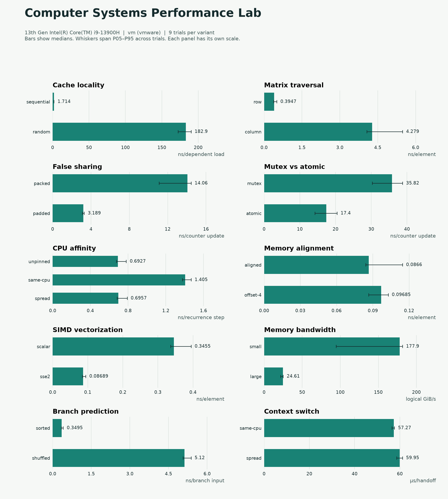

# VMware Ubuntu 實測紀錄

- 時間為 2026-11-26 02:53（Asia/Taipei），run ID `20261125T185306-7f7ebbb379cb`。
- VMware Ubuntu 24.04.5 LTS、Linux 7.0.0-42-generic、x86-64。Guest 回報
  Intel Core i9-13900H、2 vCPUs、64 B cache line、24 MiB LLC。
- GCC 13.3.0，`-std=c++17 -O3 -Wall -Wextra -Wpedantic -pthread -fno-lto -fno-loop-interchange`。
- 21 個版本各執行 2 次 warm-up 與 9 次有效 trial，共 189 筆。Standard workload、seed 2026。
  各次 CPU、RSS、thread count、affinity、操作數及 checksum 保存在 [JSON](results.json) 與 [CSV](results.csv)。

## 實驗中位數

| 實驗 | 版本與實測中位數 | 單位 |
|---|---|---|
| Cache Locality | Sequential 1.714／Random 182.9 | ns / dependent load |
| Matrix Traversal | Row 0.3947／Column 4.279 | ns / element |
| False Sharing | Packed 14.06／Padded 3.189 | ns / update |
| Mutex vs Atomic | Mutex 35.82／Atomic 17.40 | ns / update |
| CPU Affinity | Unpinned 0.6927／Same CPU 1.405／Spread 0.6957 | ns / recurrence step |
| Memory Alignment | Aligned 0.08660／+4 B 0.09685 | ns / element |
| SIMD Vectorization | Scalar 0.3455／SSE2 0.08689 | ns / element |
| Memory Bandwidth | Small 177.9／Large 24.61 | logical GiB/s |
| Branch Prediction | Sorted 0.3495／Shuffled 5.120 | ns / branch input |
| Context Switch | Same CPU 57.27／Spread 59.95 | µs / handoff |

## 如何解讀

- Cache locality 的 random 版本約 170–190 ns/load 的 trial 分布，且有較多非自願切換。
  這組測到的是相依存取、資料排列和 VM 排程共同作用下的延遲。Matrix 兩版都使用 scalar，
  欄方向 8192 B stride 仍與列方向 4 B stride 有明顯落差。
- False sharing 兩版的 CPU 使用率中位數均超過 190%，更新成本仍差約 4.4 倍。
  Mutex 與 atomic 的試驗則有意讓兩個 threads 更新同一項 counter，屬 true sharing。
- Affinity 的 same-cpu、中位 CPU 使用率約 99.5%，兩個可平行的版本約 197–198%。
  Unpinned 與 spread 的中位數接近且分布重疊。Alignment 的 P05–P95 也重疊，
  aligned 範圍 0.08425–0.1146 ns/element，+4 B 為 0.08655–0.1028。
- Bandwidth 的兩個工作集為 32 KiB 與 256 MiB，Peak RSS 中位數約 3.53／259.50 MiB。
  GiB/s 用程式指定的 logical read + write bytes 計算。Small 的 P05 約 94.72 GiB/s，
  與中位數有落差，顯示短批次在此 VM 仍有明顯波動。
- Context handoff 的 voluntary switches 中位數約 60485／60083，
  involuntary switches 約 53206／27。相同交接數仍出現不同排程行為。
  Handoff 時間包含 condition variable、喚醒、排程與鎖的成本。
- 此次 `perf_event_paranoid=4`。Cycles、instructions、IPC、cache misses、
  branch misses，以及 perf 的 context switches／CPU migrations 均為 `unavailable`。
  上述兩種切換數是 Linux `getrusage` 在計時範圍的觀測。Guest CPU 拓撲及結果的解讀
  限於此次虛擬環境，精確的微架構結論仍需裸機重測。

## 同一台 VM 的正確性驗證

- `make -B -j2 all` 重新建置原課程九支 C++ 程式。
- `make test-lab` 的 5 個測試全部通過，涵蓋 21 個版本的 checksum 和等價工作量、
  輸入錯誤、統計、無 perf 權限資料、CSV／JSON 及 loopback Dashboard route。
- `make test` 的 21 個 Python 回歸測試與 Linux smoke 全部通過。
  `make test-demo-ui` 的四個課程場景、`make test-demo-proof` 的真實子程序、
  `/proc` 取樣、取消、重跑、port 衝突與非零 exit path 也通過。
- `objdump` 查核此 GCC 建置仍有 pointer-chase 相依載入、兩種 matrix stride、scalar add、
  SSE2 `movdqu` / `paddd`、資料相關的跳躍、recurrence 迴圈、atomic `lock add`
  和重複呼叫 `memcpy` 的迴圈。

[各實驗的設計、限制與重現指令](../../PERFORMANCE_LAB.md)
